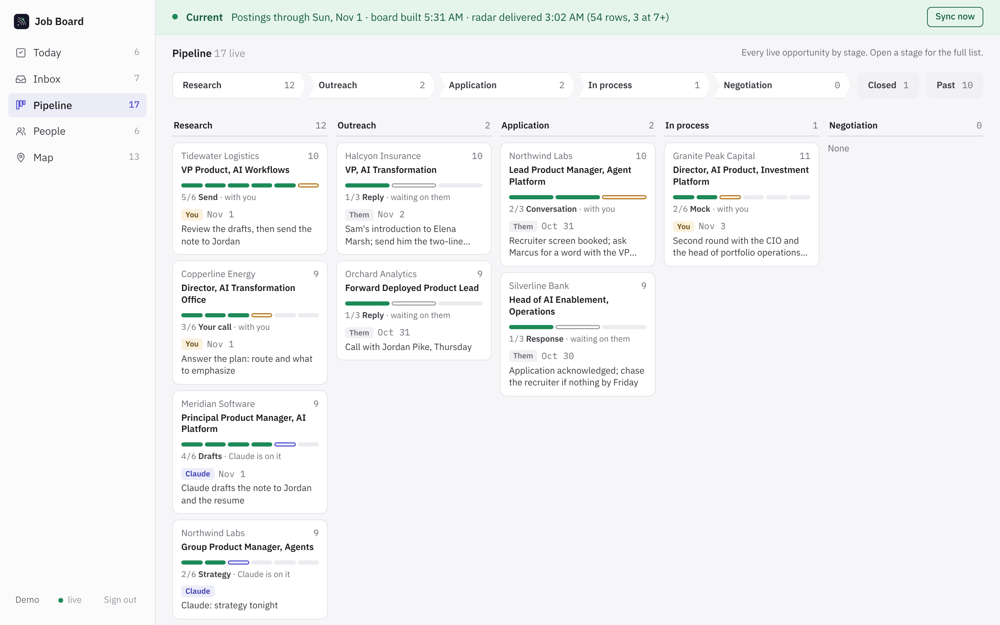
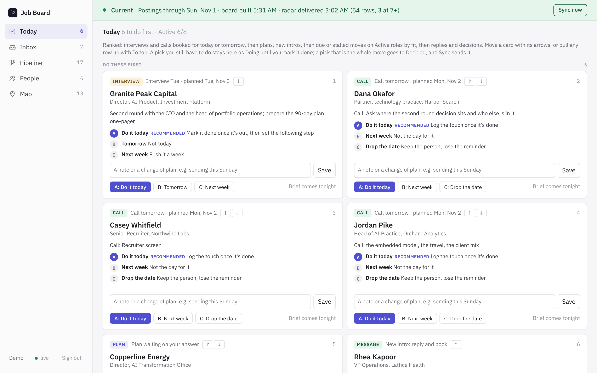
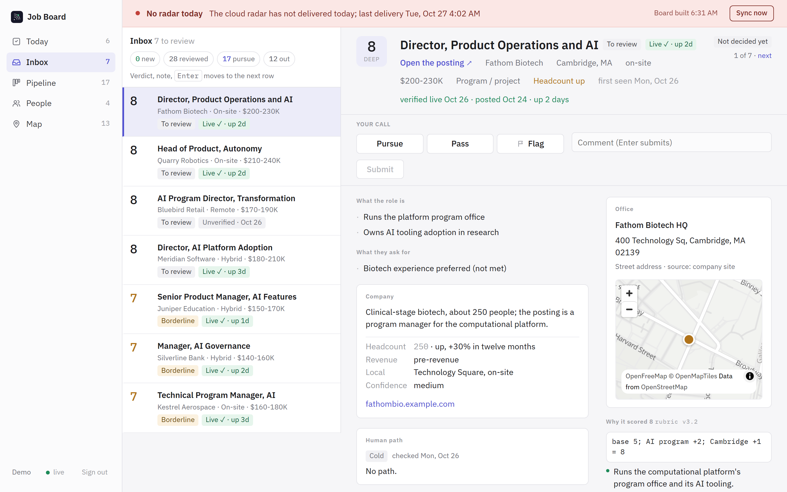
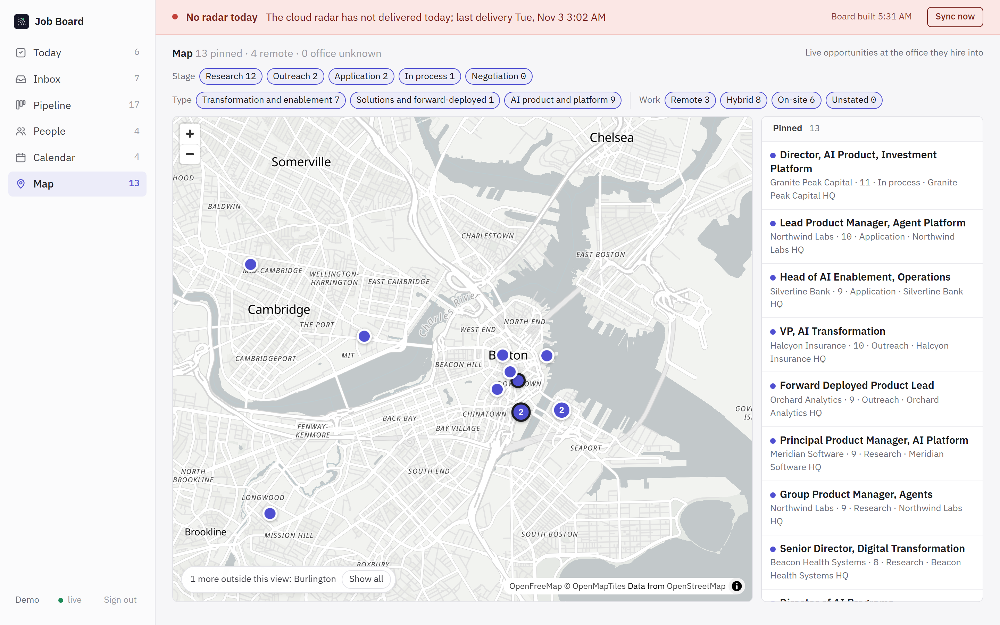
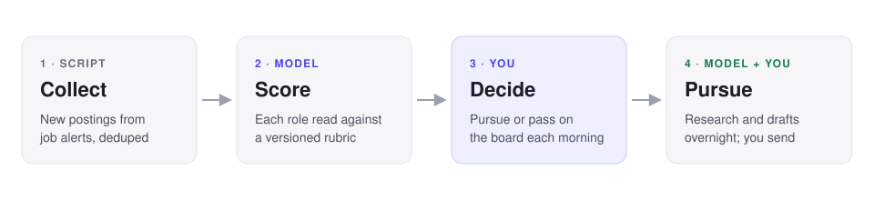

# Job Search Board

A one-screen command center for a senior job search, built and run with [Claude Code](https://claude.com/claude-code). Every morning it finds new roles, scores them against a rubric, and puts the ones worth a look in front of you. You make the calls; it keeps the record.

**[Open the live demo](https://demo.mattfuchs.dev/job-board/)**: the real page on invented data, no sign-in.

## What it does

- **Finds the roles.** Job alerts are collected and deduped overnight; a model scores each one against a rubric that improves from every verdict.
- **Keeps one list to act from.** Interviews, calls, follow-ups and decisions, ranked for today.
- **Tracks every opportunity.** Each role moves through a pipeline from research to offer, with the people, notes and next step in one place.
- **Works on a phone and a laptop,** in sync.

  
  
  

## How it works

Plain scripts do the plumbing, a model does the reading and drafting, and a person makes every decision. Built with Python, Supabase and a static page; no framework.

## Build your own

Run the demo locally with any static server (`py -m http.server 8742 --directory web`). To build a real board, hand **[BUILD-WITH-AI.md](BUILD-WITH-AI.md)** to Claude Code or another coding agent: it covers what to read, what to adapt and how to set up Supabase and hosting.

## Credits

Built by Matt Fuchs with Claude Code in fall 2026 as the engine behind a real search. Every company, person and posting in the demo is invented. MIT licensed.
